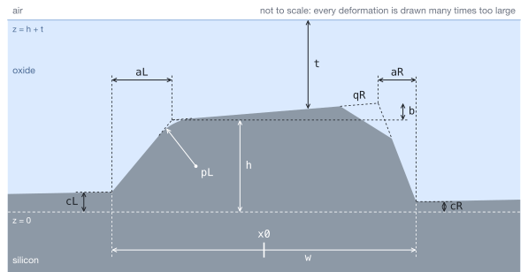

# The model

Everything a solver needs to reproduce a pair. Lengths are in nm. The pitch is `P = 2000`.

## The mark

One period, `x0 - P/2 <= x < x0 + P/2`, holds one raised silicon line; `z` points up. A mark is its placement `x0` and twelve parameters, always in this order:

| | parameter | range | meaning |
|---|---|---|---|
| `w` | line width | 950 to 1050 | distance between the two feet of the line |
| `h` | line height | 144 to 176 | height of the left top corner |
| `t` | oxide thickness | 760 to 840 | the oxide surface is the plane `z = h + t` |
| `cL`, `cR` | floor tilt | 0 to `r` | the left and right feet rise to heights `cL` and `cR` |
| `aL`, `aR` | sidewall slope | 0 to `r` | each top corner moves inward by `a`; the feet stay |
| `b` | top tilt | `-r` to `r` | the right top corner is at height `h + b` |
| `pL`, `pR` | corner rounding | 0 to `r` | the top corner becomes a circular arc of radius `p`, tangent to the wall and the top |
| `qL`, `qR` | corner chamfer | 0 to `r` | the top corner is cut by the straight segment joining the points at distance `q` from it along the wall and along the top |

- **Undeformed line:** feet at `(x0 - w/2, 0)` and `(x0 + w/2, 0)`, vertical walls, flat top at height `h`, trench floor at `z = 0`. The nominal mark is `w = 1000`, `h = 160`, `t = 800` with every other parameter zero.
- **Deformed line:** feet at `(x0 - w/2, cL)` and `(x0 + w/2, cR)`, top corners at `(x0 - w/2 + aL, h)` and `(x0 + w/2 - aR, h + b)`, straight walls from foot to corner, a straight top between the corners. The floor of each trench is the straight segment from the right foot of one line, `(x0 + w/2, cR)`, to the left foot of the next, `(x0 + P - w/2, cL)`.
- A top corner carries a rounding or a chamfer, never both. Each wall must rise from its foot to its corner, every tangent or cut point must lie within its edge, and the two corners' modifications must not overlap on the top.
- Silicon fills everything below the profile, silicon dioxide from the profile up to the plane `z = h + t`, air above.
- **Placement** is `x0`, the midpoint of the line's feet. No deformation moves it. Every separation in this repository is a distance between two placements; each record also gives the distance between the centroids of the two lines' cross-sections (the region between a line's profile and the chord joining its feet), which is a different number.
- **Cap** `r`: the largest value any of the nine deformation parameters may take. The pairs here use 10, 20, 40 and 80.
- **Mirror image.** The mark `(w, h, t, cL, cR, aL, aR, b, pL, pR, qL, qR)` reflected left to right is the mark `(w, h + b, t - b, cR, cL, aR, aL, -b, pR, pL, qR, qL)`.
- Raising both feet and the top by the same amount, `(h, cL, cR) -> (h + D, cL + D, cR + D)` with `t` fixed, lifts the whole structure and changes no reading.

## Optics

- Silicon: `data/si-green-2008.yml`, with `n` and `k` interpolated linearly in wavelength. Silicon dioxide: `data/sio2-malitson-1965.yml`, a Sellmeier formula. Air: `n = 1`. Permittivity `(n + ik)^2`, time dependence `exp(-i omega t)`.
- A plane wave of unit amplitude falls from the air at normal incidence.
- **Channels:** 532, 633, 775 and 850 nm, each in TE (electric field along the lines) and TM (magnetic field along the lines).
- `A+` and `A-` are the complex amplitudes of the reflected +1 and -1 orders in air (the field component along the lines; order +1 varies as `exp(+2 pi i x / P)`), computed with the mark at `x0 = 0`. `e+` and `e-` are their diffraction efficiencies, `|A|^2 kz / k0` with `kz` the normal wavevector component of the order in air.

With the opposite labelling of the two orders every shift changes sign.

## What a channel measures

- **Position reading** `X = x0 - (P / 4 pi) arg(A+ / A-)`. A mark that is its own mirror image reads `x0`. Readings are defined modulo `P/2 = 1000`.
- **Fringe visibility** `V = 2 sqrt(e+ e-) / (e+ + e-)`.
- **Signal strength** `S = (e+ + e-) / S0`, with `S0` the same channel's `e+ + e-` for the nominal mark.

The records also give the **order imbalance** `(e+ - e-) / (e+ + e-)`. The sensor of this model does not read it: it takes the two first orders together, which is what `V` and `S` describe.

## When two marks cannot be told apart

Each measured quantity carries Gaussian noise of standard deviation `sigma`, the same in every channel. For two marks, `d^2` sums, over the channels read and the quantities read, the squared difference of the two marks' values divided by `sigma^2`. A quantity with `sigma = 0` must agree between the two marks. The marks are **indistinguishable** when `d <= 1`: no test on a single measurement then tells them apart with a success rate above 69%.

A pair file states its channels and its three noise levels (position, visibility, strength). A pair that is indistinguishable there stays so with fewer channels, with more noise, with a quantity left unread, and under any larger cap.

## Where it comes from

- The grating, the stack, the eight channels and the five deformation types with their 0 to 80 nm range follow P. Song et al., "Adaptive Weighted Error-Correction Method Based on the Error Distribution Characteristics of Multi-Channel Alignment", Sensors 24, 2756 (2024), https://doi.org/10.3390/s24092756 (CC BY 4.0), sections 2 and 3 and Figure 3. Only its model is used. Deformations on both sides and in combination, the ranges of `w`, `h` and `t`, the visibility and strength readings, the noise levels and the rule for telling marks apart are choices made here.
- `data/si-green-2008.yml`: M. A. Green, Sol. Energ. Mat. Sol. Cells 92, 1305 (2008). `data/sio2-malitson-1965.yml`: I. H. Malitson, J. Opt. Soc. Am. 55, 1205 (1965). Both as tabulated by the refractiveindex.info database (CC0 1.0), unmodified, checksums in `data/SHA256SUMS`.
