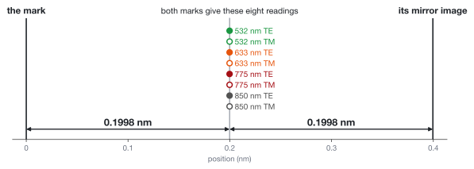
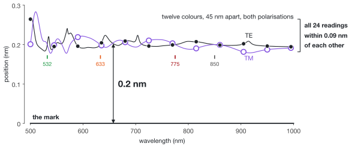
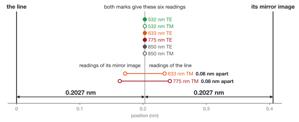

# Four colours, two polarisations, one reading. The mark is 0.2 nm away.

Multi-colour wafer alignment takes agreement between colours as the sign of a mark it can trust. Here is a mark on which four colours agree exactly, any twelve between 500 and 1000 nm agree to within 0.11 nm, and every one of them is about 0.2 nm wrong.

The setting is a two-dimensional electromagnetic model of a silicon grating mark under oxide. Read at 532, 633, 775 and 850 nm in both polarisations, all eight channels put this mark at one position, the same to within 6e-13 nm. That position is 0.1998 nm from the midpoint of the line's feet, which is where the model says the mark is. Its mirror image, placed 0.3996 nm away, returns the same eight positions, the same fringe visibilities and the same signal strengths. Nothing in those twenty-four numbers tells the two marks apart.



## More colours do not find it



At every wavelength from 500 to 1000 nm, in 1 nm steps and both polarisations, the same mark is read between 0.178 and 0.283 nm from where it is. Take twelve colours, here 45 nm apart from 500 to 995 nm, in both polarisations: the 24 readings run from 0.181 to 0.264 nm, with a mean of 0.202 nm and a standard deviation of 0.015 nm. A reading that steady through colour is what a trustworthy mark looks like, and this one is 0.2 nm away. Whichever twelve of those wavelengths are chosen, no two readings differ by more than 0.11 nm and none comes within 0.17 nm of the mark. The four ticks are the wavelengths of the first figure, where the two polarisations meet.

What the extra colours do carry is the pattern of their small disagreement, which is reversed for the mirror image: a colour away from the four separates the two marks by twice its own distance from 0.1998 nm, at most 0.13 nm among these twelve. Below 500 nm the first orders fade, and near 462 nm, where the 158 nm line is half a wavelength deep in oxide, they vanish and the reading swings by tens of nanometres.

## The mark

The line is 158 nm high and 1045 nm wide at its feet, with walls at 63° and shoulders rounded to 65 nm, under 767 nm of oxide. Its left and right sides differ by 0.64 nm in the lean of the walls, 0.86 nm in the radius of the shoulders and 0.03 nm in the height of the feet.

| | | nm |
|---|---|---|
| `w` | width at the feet | 1044.886194285289 |
| `h` | height of the top at its left end | 169.68429509660422 |
| `t` | oxide above that | 767.4360205237359 |
| `cL`, `cR` | height of the left and right foot, from the same zero | 11.23929554668171, 11.265491374511235 |
| `aL`, `aR` | lean of the left and right wall | 79.93130058547573, 79.29019783659112 |
| `b` | rise of the top from left to right | 0.001019457000732477 |
| `pL`, `pR` | radius of the left and right shoulder | 64.15922532073957, 65.02268614477957 |
| `qL`, `qR` | chamfer of the left and right shoulder | 0, 0 |

[MODEL.md](MODEL.md) defines these twelve numbers on one page, with the optics and the sign conventions. With the midpoint of its feet at 0, the eight channels return:

| channel | position reading (nm) | fringe visibility | signal strength | order imbalance |
|---|---|---|---|---|
| 532 nm TE | 0.199788172419 | 0.9999999803 | 0.8553 | +0.0198% |
| 532 nm TM | 0.199788172419 | 0.9999991686 | 0.8650 | -0.1289% |
| 633 nm TE | 0.199788172419 | 0.9999999679 | 0.9563 | +0.0253% |
| 633 nm TM | 0.199788172419 | 0.9999998743 | 0.9783 | -0.0501% |
| 775 nm TE | 0.199788172419 | 0.9999999936 | 1.0670 | +0.0113% |
| 775 nm TM | 0.199788172419 | 0.9999999152 | 1.1084 | -0.0412% |
| 850 nm TE | 0.199788172419 | 0.9999999998 | 1.0210 | +0.0022% |
| 850 nm TM | 0.199788172419 | 0.9999999446 | 1.0064 | -0.0333% |

The mirror image, with left and right exchanged and the midpoint of its feet at 0.3995763448 nm, returns the same readings, visibilities and strengths, and the opposite imbalances. Put the numbers into any rigorous solver, or run the one here, which needs only numpy and scipy and takes a few minutes:

```
python check.py pairs/01-r80-all8-identical.txt
```

Where a deformed line "is" is a convention. The model takes the midpoint of its feet, which no deformation in it moves. Measured between the centroids of the two lines' cross-sections instead, the same two marks are 0.17 nm apart: the eight channels do not read the centre of gravity either.

## Why nothing in the data shows it

The sensor finds a grating from the phase between its +1 and -1 diffracted orders. A line that is its own mirror image gives the two orders the same phase, and every colour reads its centre. A left-right asymmetry adds a phase difference and moves the reading, by a different amount in each colour and polarisation: tilt this line's floor or its top by half a nanometre and the eight channels scatter over 1.6 to 2.1 nm. That disagreement is how an asymmetric mark is noticed, and what a colour-weighted correction is fitted to.

Mirroring a mark swaps its two orders. So the mirror image has the same fringe visibility and the same signal strength in every channel, and the opposite shift. If a deformation shifts every channel by the same δ, the mark at x and its mirror image at x + 2δ give the sensor identical data, and the two placements differ by 2δ. No weighting of the colours and no use of those intensities can choose between them.

Such a deformation exists because a line has more shape than eight readings can pin down. An equal shift in eight channels is seven conditions; this model's line has four ways to be asymmetric (floor, top, walls, shoulders) and five symmetric dimensions that set how each of them acts on each colour. Lean one wall of this line half a nanometre more than the other and the eight channels already move almost together, by 0.14 to 0.18 nm. Newton's method on the equal-shift conditions finds the mix of the four that moves them as one. The count is of unknowns against equations and is not a proof; the mark above is the proof. The same count says a line with only these nine dimensions cannot be exactly blind in many more than ten channels. What a line with more ways to deform can hide, this model does not say.

## What breaks the tie

Fringe visibility and signal strength take the two first orders together. Read separately, their powers differ: the last column of the table above is that difference over their sum, 0.002% to 0.13% for this mark, with the opposite sign for its mirror image. A sensor that resolves it knows which of the two marks it has. Over the 47 mirror pairs here the largest such difference in a blind channel runs from 0.008% to 1.1%.

## How little deformation it takes

The mark above needs walls that lean 80 nm. Smaller deformations leave fewer blind channels, not none. Pair 19 is a nearly perfect line, its walls leaning 2 nm and its shoulders rounded by 1 to 3 nm. In six of the eight channels, all four colours in TE among them, it and its mirror image return identical data from 0.41 nm apart; the other two channels see them differ by 0.06 and 0.08 nm.



[pairs/](pairs/README.md) lists all 51 pairs, with what channels elsewhere between 500 and 1000 nm see of each: a median difference between the two marks of 0.004 to 0.16 nm. The tables give the largest distance between two marks among the pairs, in nm, by the cap on every deformation.

All eight channels, by what the sensor reads in each:

| the sensor reads | 10 nm | 20 nm | 40 nm | 80 nm |
|---|---|---|---|---|
| position, visibility and strength, all exactly | none found | none found | none found | 0.400 |
| position to 0.01 nm, visibility and strength exactly | 0.076 | 0.092 | 0.120 | 0.530 |
| position to 0.01 nm, visibility and strength to 0.001 | 0.105 | 0.105 | 0.120 | 0.530 |
| position to 0.01 nm, visibility and strength to 0.01 | 0.201 | 0.201 | 0.201 | 0.530 |
| position only, exactly | 0.491 | 0.491 | 0.491 | 0.491 |

"To 0.01 nm" is the standard deviation of the noise on each reading, and two marks count as one when no single measurement separates them with better than 69% odds.

Everything read exactly, by how many of the eight channels are read: the number of channel sets for which a pair with identical data sits more than 0.1 nm apart.

| channels read | 10 nm | 20 nm | 40 nm | 80 nm |
|---|---|---|---|---|
| any 4 or fewer | all 162 | all 162 | all 162 | all 162 |
| 5 | 49 of 56 | all 56 | all 56 | all 56 |
| 6 | 8 of 28 | 21 of 28 | all 28 | all 28 |
| 7 | none found | 1 of 8 | 3 of 8 | all 8 |
| all 8 | none found | none found | none found | 1 of 1 |

Four colours in TM alone are blind at the 10 nm cap as well, to 0.12 nm. And with positions alone, two different lines deformed by under 7 nm return the same eight readings from 0.49 nm apart.

Every entry is a lower bound. The pairs were built to pass 0.1 nm, not to be as far apart as possible, and "none found" is not "none exists": no upper bound is known for any cell of either table.

## Where this sits

That a deformation can pass for a displacement is known. Diffraction-based overlay calls it a phase asymmetry: a deformation that moves a target's centre of gravity reads as overlay, and when it is large several wavelengths are not enough to recover it ([Mathijssen et al., Proc. SPIE 11611, 1161121, 2021](https://doi.org/10.1117/12.2584973)). Colour weighting corrects what the colours disagree on ([Menchtchikov et al., Proc. SPIE 10587, 105870C, 2018](https://doi.org/10.1117/12.2297493); [Song et al., Sensors 24, 2756, 2024](https://doi.org/10.3390/s24092756), whose mark model this is). What is here is that blind spot made explicit for an alignment mark: marks anyone can re-solve, on which the colours do not disagree at all, with how much deformation they take and what exposes them. The model is two-dimensional, and nothing here is a statement about a production mark or sensor.

## Check everything

Two solvers that share no code, boundary integrals in [bie/](bie/) and high-order finite elements in [fem/](fem/), agree on every reading of all 51 pairs to 7e-9 nm, on every visibility to 1e-13 and on every strength to 5e-11. On the spectrum above they agree to 2e-7 nm, compared every 5 nm from 500 to 1000 nm. Their data are in [records/](records/).

```
python check.py pairs/01-r80-all8-identical.txt          # one pair, boundary integrals
python check.py pairs/01-r80-all8-identical.txt --fem    # the same pair, finite elements (needs ngsolve)
python check.py pairs/01-r80-all8-identical.txt --band 500 995 45    # the twelve colours
python summary.py                                        # every number on this page, from records/
python figures/make.py                                   # the figures
```

Licence: CC0 1.0. The optical constants in `data/` come from refractiveindex.info, also CC0 1.0.
